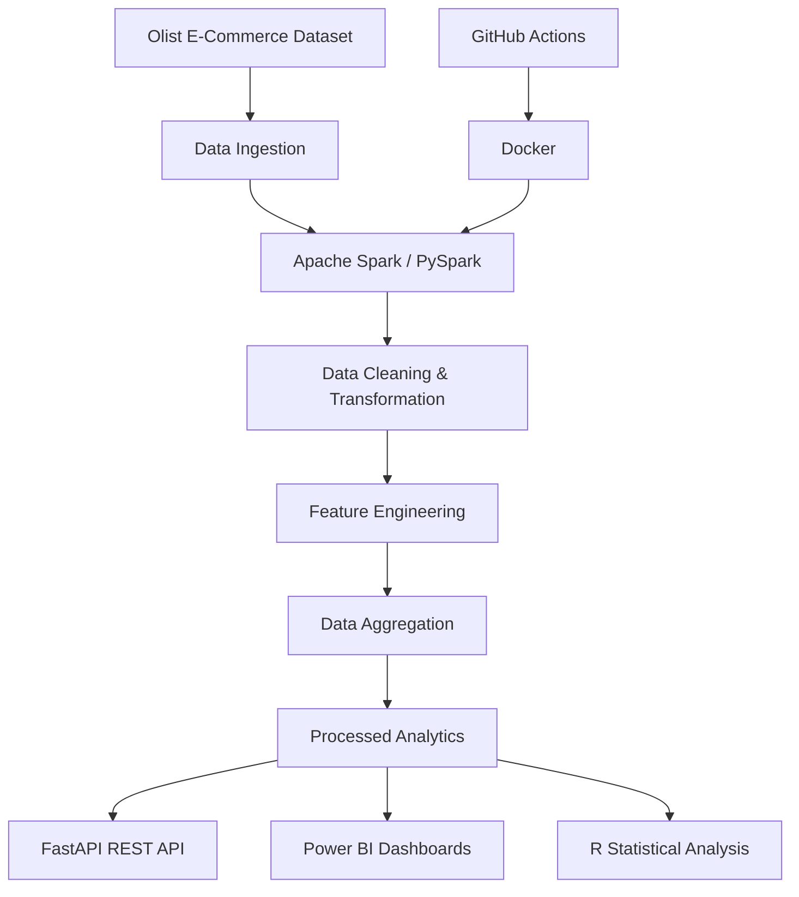

# 🛒 E-Commerce Data Engineering & Analytics Pipeline

An end-to-end e-commerce data engineering and analytics project that processes transactional data using **Apache Spark (PySpark)**, exposes business insights through a **FastAPI REST API**, and supports analytics and visualization through **Power BI** and R.

The project demonstrates a data processing workflow involving data ingestion, transformation, cleaning, feature engineering, aggregation, API development, containerization, and automation.

---

## 🚀 Project Overview

This project analyzes e-commerce transactional data to extract meaningful business insights, including:

- **Sales Analysis:** Analyze total sales across different customer cities.
- **Sales Trends:** Identify monthly sales patterns and trends.
- **Product Performance:** Identify the most frequently purchased products.
- **Data Processing:** Clean, transform, join, and aggregate large datasets using Apache Spark.
- **REST API:** Expose processed analytical results through FastAPI endpoints.
- **Visualization:** Support business intelligence and statistical analysis through Power BI and R.

The pipeline uses the Olist Brazilian E-Commerce dataset to perform analytical processing across orders, customers, and order items.

## 🏗️ System Architecture



## ⚙️ Technology Stack

| Category | Technologies |
|---|---|
| Programming | Python |
| Big Data Processing | Apache Spark, PySpark |
| Data Manipulation | Pandas |
| Backend | FastAPI |
| API Server | Uvicorn |
| Data Visualization | Power BI |
| Statistical Analysis | R |
| Containerization | Docker |
| Automation | GitHub Actions |
| Dataset | Olist Brazilian E-Commerce |

## 🔄 Data Processing Workflow

### 1. Data Ingestion
Load the Olist transactional datasets, including:
- Orders
- Customers
- Order Items

### 2. Data Cleaning
Perform data preparation using PySpark:
- Handle missing values.
- Remove duplicate records.
- Filter invalid transactions with non-positive prices.
- Join related datasets using customer and order identifiers.

### 3. Feature Engineering
Extract additional analytical features, including the purchase month from order timestamps.

### 4. Data Aggregation

Generate three primary analytical outputs:

| Analysis | Description |
|---|---|
| Sales by City | Aggregate total sales across customer cities |
| Monthly Sales Trend | Analyze sales patterns by purchase month |
| Top Products | Rank products based on order-item frequency |

### 5. API Development

FastAPI provides REST endpoints to access the processed analytical data.

| HTTP Method | Endpoint | Functionality |
|---|---|---|
| GET | `/` | API health/message endpoint |
| GET | `/sales/city` | Retrieve sales by city |
| GET | `/sales/trend` | Retrieve monthly sales trends |
| GET | `/products/top` | Retrieve top products |

## 📂 Project Structure

```text
ecommerce-devops/
│
├── .github/
│   └── workflows/          # GitHub Actions workflows
│
├── backend/
│   └── app.py              # FastAPI application
│
├── dataset/                # E-commerce datasets
│
├── output/                 # Processed analytical outputs
│
├── powerBI/                # Power BI analytics
│
├── r_scripts/              # R-based analysis
│
├── spark/
│   └── process_data.py     # PySpark processing logic
│
├── Dockerfile              # Docker configuration
├── pipeline.py             # Pipeline execution script
└── README.md
```

## 🐳 Getting Started

### Prerequisites

Make sure you have the following installed:

- Python 3.11+
- Java JDK (required by Spark)
- Docker
- Git

### 1. Clone the Repository

```bash
git clone https://github.com/dapinderbhullar/ecommerce-devops.git

cd ecommerce-devops
```

### 2. Install Dependencies

```bash
pip install fastapi uvicorn pyspark pandas
```

### 3. Run the Data Processing Pipeline

```bash
python pipeline.py
```

This executes the PySpark processing script and generates the analytical datasets.

### 4. Start the FastAPI Server

```bash
uvicorn backend.app:app --host 0.0.0.0 --port 8000
```

Access the API:

- API: http://localhost:8000
- Interactive API Documentation: http://localhost:8000/docs

### 5. Run Using Docker

Build the Docker image:

```bash
docker build -t ecommerce-analytics .
```

Run the container:

```bash
docker run -p 8000:8000 ecommerce-analytics
```

## 📊 API Examples

**Sales by City**

```http
GET /sales/city
```

**Monthly Sales Trend**

```http
GET /sales/trend
```

**Top Products**

```http
GET /products/top
```

Interactive documentation is available through FastAPI Swagger UI at `/docs`.

## 📈 Analytics & Insights

The project produces analytical datasets that can be used to explore:

- Geographic distribution of e-commerce sales.
- Monthly revenue patterns.
- Product popularity and purchasing frequency.
- Business performance across different customer locations.

Power BI and R components provide additional avenues for analyzing and presenting these insights.

## 🎯 Key Learning Outcomes

- Implementing distributed data processing using Apache Spark.
- Building data transformation and aggregation pipelines.
- Working with relational e-commerce datasets.
- Developing RESTful APIs using FastAPI.
- Containerizing Python applications using Docker.
- Organizing analytical workflows and automation using GitHub Actions.
- Integrating data engineering outputs with business intelligence tools.

## 🔮 Future Improvements

- Implement a fully automated CI/CD pipeline.
- Introduce Apache Airflow for scheduled workflow orchestration.
- Integrate PostgreSQL for persistent analytical storage.
- Add API authentication and request validation.
- Implement automated data quality checks.
- Deploy the application using a cloud platform.
- Add interactive dashboards for real-time business insights.

---

## 👨‍💻 Author

**Dapinder Bhullar**

B.Tech Computer Science & Engineering

- GitHub: [@dapinderbhullar](https://github.com/dapinderbhullar)

---

⭐ If you find this project interesting, consider giving it a star!
